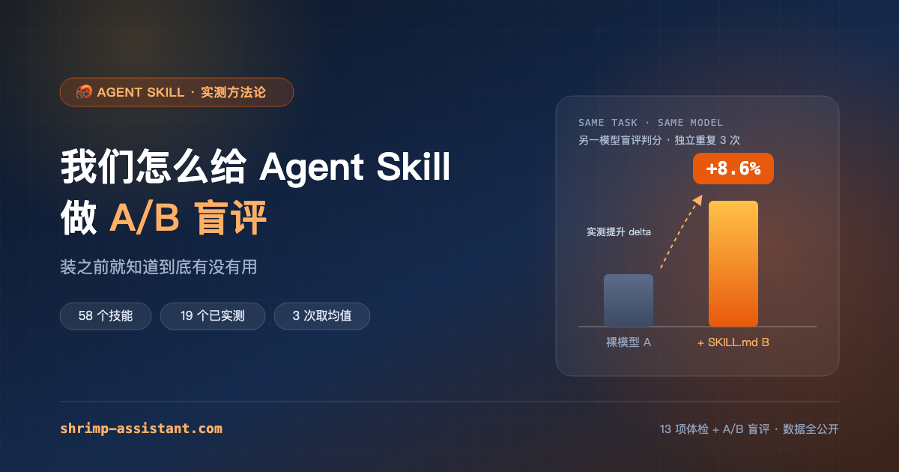
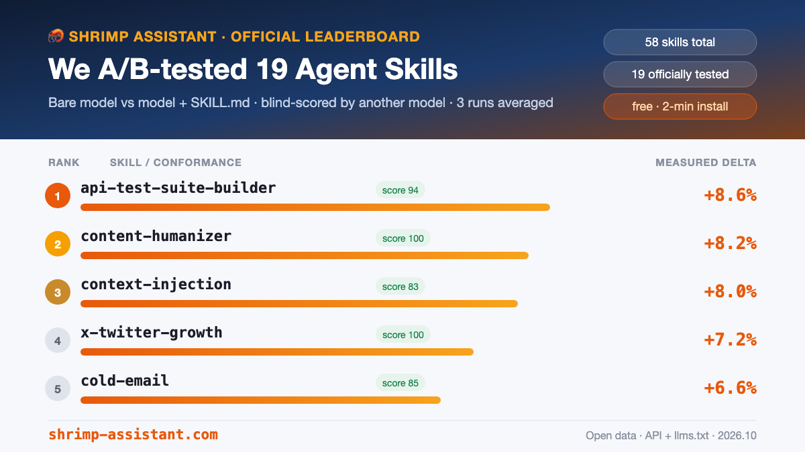

<div align="center">



# 我们怎么给 Agent Skill 做 A/B 盲评

**装之前就知道有没有用 —— 一个给 SKILL.md 做实测的排行榜**

[](https://shrimp-assistant.com/?utm_source=github&utm_medium=readme&utm_campaign=article)
[](https://shrimp-assistant.com/?utm_source=github&utm_medium=readme&utm_campaign=article)
[](https://shrimp-assistant.com/?utm_source=github&utm_medium=readme&utm_campaign=article)
[](LICENSE)

</div>

> **English TL;DR** — Every AI Agent Skill (SKILL.md) in the wild claims to be useful, but nobody measures whether it actually is. We run blind A/B evals: same task, bare model vs. model + SKILL.md, scored blind by a third model, averaged over 3 runs. Only relative deltas are published, so scores are comparable across skills. 58 skills indexed, 19 officially tested, deltas ranging from +0.8% to +8.6%. Open data: `curl -s https://shrimp-assistant.com/api/skills.php?sort=rating`

---

## 目录

- [1. 问题：Skill 生态存在「疗效真空」](#1-问题skill-生态存在疗效真空)
- [2. 第一层：13 项规范体检](#2-第一层13-项规范体检)
- [3. 第二层：A/B 盲评](#3-第二层ab-盲评)
- [4. 三个刻意的设计决定](#4-三个刻意的设计决定)
- [5. 首批实测结果](#5-首批实测结果)
- [6. 已知局限](#6-已知局限)
- [7. 复现与开放数据](#7-复现与开放数据)
- [8. 参与](#8-参与)

---

## 1. 问题：Skill 生态存在「疗效真空」

Claude Code、Codex、Cursor 支持 `SKILL.md` 之后，社区技能数量涨得很快。但有一个尴尬的事实：

**没有任何一个 Skill 告诉你，装上之后任务完成度提升了多少。**

README 都写得很漂亮，功能列表都很全，可是：

- 有的 Skill 装上后模型行为几乎没变化；
- 有的 Skill 让模型跑偏（提示词过重、指令冲突）；
- 更常见的是「感觉有点用，但说不出有多大用」。

每装一个没用的 Skill，代价不只是下载时间——`SKILL.md` 常驻上下文，持续消耗 token，还会稀释真正重要的指令。

所以我们做了一个笨但有效的决定：**像测试软件一样测试 Skill。**

---

## 2. 第一层：13 项规范体检

盲评之前先做「体检」，检查一个 Skill 作为 `SKILL.md` 的规范完整度：

| 维度 | 分值 | 检查内容 |
|---|---:|---|
| 元信息 | 30 | `name` / `description` 是否规范、触发条件是否明确、版本号是否齐全 |
| 内容质量 | 40 | 指令是否具体可执行、有无自相矛盾、示例是否充分 |
| 完整性 | 30 | 文件结构是否完整、依赖是否声明、路径引用是否有效 |

体检分不代表效果，代表「这个 Skill 写得认不认真」。80 分以上算佳。

---

## 3. 第二层：A/B 盲评

体检只能测形式，测不了疗效。疗效只能靠真实任务对比：

```
                ┌─────────────────┐
   同一任务  ──▶ │  A 组：裸模型    │ ──┐
                └─────────────────┘   │
                                      ├──▶ 盲评判分 ──▶ delta
                ┌─────────────────┐   │   (第三方模型)
   同一任务  ──▶ │  B 组：+SKILL.md │ ──┘
                └─────────────────┘
```

1. 为每个 Skill 设计贴近其真实使用场景的任务；
2. 同一任务跑两次：A 组裸模型，B 组装载该 `SKILL.md` 的模型，模型与参数完全一致；
3. 由**另一个模型**对两组输出盲评判分——评审不知道哪个是 A 哪个是 B，也不知道哪个装了 Skill；
4. 评分维度：**正确性 40 / 可执行性 30 / 完整性 20 / 表达 10**；
5. 每个任务独立重复 **3 次**，取 delta 均值并记录区间。

公开的指标只有一个：

```
delta = (B 组得分 - A 组得分) / A 组得分 × 100%
```

---

## 4. 三个刻意的设计决定

### 4.1 只在纯对话环境评测

评测不挂文件系统、浏览器、数据库。一旦引入外部环境，任务成败就会混入环境因素，无法归因到 Skill 本身。

代价是 **workflow 型**（需要多轮交互、工具调用的）Skill 会被低估——所以数据里明确标注 `skill_type`，workflow 型的分数请打折参考。

### 4.2 只公开相对提升，不公开绝对分

绝对分取决于任务难度和评审模型，横向不可比；相对提升是同一任务内部的差值，可比性强得多。所有榜单分数都能横向比较，这是「官方榜」的前提。

### 4.3 评审模型与执行模型必须不同，且盲评

评审知道哪份装了 Skill，就会有「高估」倾向——这是提示词评测里最常见的偏差。盲评 + 第三方模型，把偏差压到最低。

---

## 5. 首批实测结果



| # | Skill | delta | 体检分 | 类型 |
|---:|---|---:|---:|---|
| 1 | `api-test-suite-builder` | **+8.6%** | 94 | workflow |
| 2 | `content-humanizer` | **+8.2%** | 100 | output |
| 3 | `context-injection` | **+8.0%** | 83 | knowledge |
| 4 | `x-twitter-growth` | **+7.2%** | 100 | output |
| 5 | `cold-email` | **+6.6%** | 85 | output |
| 6 | `ad-creative` | **+5.4%** | 95 | output |
| 7 | `email-sequence` | **+4.9%** | 95 | output |

（完整榜单见 [shrimp-assistant.com](https://shrimp-assistant.com/?utm_source=github&utm_medium=readme&utm_campaign=article)）

两点观察：

1. **output 型（单轮直接出成品）Skill 的实测提升普遍更高**——单轮任务里提示词的影响是「全程在线」的；workflow 型普遍落在 +1~4% 区间。
2. **体检分高 ≠ delta 高**。`content-humanizer` 与 `x-twitter-growth` 都是体检满分，但一个是 +8.2%、一个是 +7.2%；也有 90+ 分的 Skill 只有 +0.8%。规范性和有效性是两件事，这也是两个分数要分开看的原因。

---

## 6. 已知局限

坦白说，这套方法并不完美：

- **workflow 型被低估**：纯对话环境无法体现多轮工具调用的价值；
- **样本量有限**：每个 Skill 3 次重复，够看出方向，不够做统计显著性；
- **任务设计有主观性**：任务由我们设计，可能偏向某类 Skill 的强项；
- **模型版本会漂移**：评测结果绑定当时的模型版本，换模型后需要重测。

这些限制都写在榜单页面上，不做隐藏。

---

## 7. 复现与开放数据

整个索引是开放数据，CORS 全开，无需登录：

```bash
# 全量技能索引（JSON，含 delta / quality_score / rating）
curl -s "https://shrimp-assistant.com/api/skills.php?sort=rating"

# 站点 Markdown 索引（给 LLM 抓取用）
curl -s "https://shrimp-assistant.com/llms.txt"

# RSS 与站点地图
curl -s "https://shrimp-assistant.com/feed.php"
curl -s "https://shrimp-assistant.com/sitemap.php"
```

关键字段：

| 字段 | 含义 |
|---|---|
| `delta` | A/B 实测相对提升（%），正数越大越好；`null` 表示尚未实测 |
| `quality_score` | 13 项规范体检分（0-100） |
| `skill_type` | `output` / `workflow` / `knowledge` |
| `rating` / `rating_count` | 用户 1-5 星评分（贝叶斯平均）与评分数 |

---

## 8. 参与

- **你是 Skill 作者**：提交上架，社区榜周榜前三免费进官方实测；
- **你怀疑某个 Skill 没用**：来 [Issues](../../issues) 点名，我们测给你看；
- **你不同意评测方法**：欢迎开 issue 辩论，这套方法一直在改。

如果这个项目对你有用，给个 ⭐ 让更多人看到。

<div align="center">

**[→ 打开完整榜单](https://shrimp-assistant.com/?utm_source=github&utm_medium=readme&utm_campaign=article)**

<sub>数据每日更新 · 各 Skill 内容遵循其原始许可（多为 MIT）</sub>

</div>

---

## License

本文与数据以 MIT 发布；被评测的 Skill 内容遵循其原始许可。
